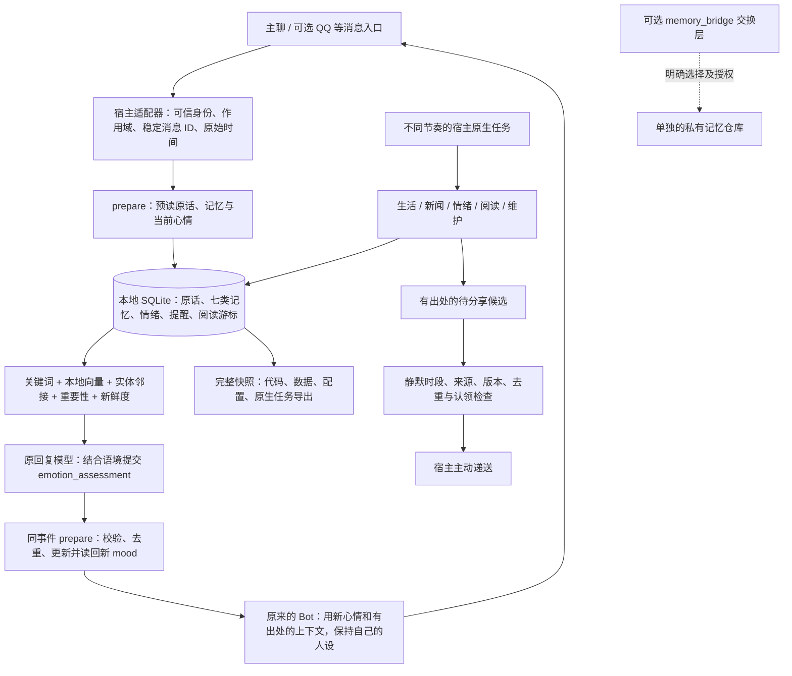

# Memory Bridge · 个人 AI 智能体记忆系统（Muse / Dot）

给能使用本地工具的**个人 AI 智能体（Personal AI Agent）**一套**可部署、可检索、可回退**的长期记忆：保存带出处的记录，按时间找原话，让情绪随真实对话变化，阅读真实材料，并在值得分享时主动联系用户。

仓库包含两个独立组件：

- **`personal_bot`（v0.3）**：本地记忆核心及部署工具，覆盖下面八项能力，是部署完整系统的入口。
- **`memory_bridge`（保留 v0.1 协议）**：可选的、逐项授权的记忆交换工具，提供只读 MCP 与私有 GitHub 同步。它不负责启动完整系统，也不自动共享 `personal_bot` 的数据库。

> 这是可自行部署的外置系统，不是 Muse / Dot 官方插件。机器人需要有相应的命令执行、文件、消息、定时任务与递送能力；读取 README 本身不会安装任何内容。Muse 的一套实际环境已验证过核心链路；其他 Muse / Dot 环境必须按能力适配后验收。

**想在另一个 Agent 复刻整套系统，先读 [系统复刻说明](docs/SYSTEM_REPLICATION.md)。** 它完整说明模型情绪、生活与自主阅读、40% 起步的表情抽签、跨渠道边界和验收步骤。v0.3 已将情绪核心改为模型提交结构化评估，不再根据“谢谢”等关键词自动加情绪；升级入口见 [模型情绪协议与迁移](docs/MODEL_EMOTION.md)。本次发布不包含新的 QQ 专用代码，也不包含可直接跨平台发送表情图片的媒体适配器。

**开发分支 v0.3.1.dev0** 新增默认关闭的[表情决策与交接账本](docs/STICKER_API.md)：基于已评估事件的一次抽签、宽松选图、文字完成后的单次媒体交接，以及素材完整备份/恢复。它仍不包含平台图片发送器或表情素材。Dot 接入前先用[能力检查与工程协作流程](docs/DOT_ADAPTER.md)确认真实入口，不能把本地测试通过称为已接通 Dot。

## 我们说的这类 AI 是什么

本项目面向**常驻型个人 AI 智能体**：面向特定用户长期服务，在可持续保留状态的计算环境中使用工具、跨会话推进任务，并在授权范围内主动反馈结果的 AI。Muse 和 dot 所代表的形态拥有自己的云端电脑、文件和浏览器。

Meta 官方使用 [personal AI agent](https://about.fb.com/news/2026/09/introducing-muse-personal-ai-agent/)，OpenAI 官方把 dot 描述为 [always-on agent](https://learn.chatgpt.com/docs/dots)。“常驻型个人 AI 智能体”是这两个现有描述的组合，并非统一的行业标准分类；云端电脑是运行形态，不是所有个人智能体都必须满足的定义条件。详见[术语与来源](docs/TERMINOLOGY.md)。

## 30 秒看懂架构



数据默认留在部署环境的本地磁盘，可以是智能体的云端电脑。项目不会自动把记忆上传到 GitHub；返回给宿主模型的记忆上下文仍受宿主平台的数据处理规则约束。向量模型只监听 `127.0.0.1:18765`，不会把私人记忆送到外部 embedding API。下载模型仍需要访问 Hugging Face。

## 都有哪些能力

| 能力 | 当前实现 | 需要理解的边界 |
|---|---|---|
| 记忆 | 事件、事实、偏好、关系、反思、技能、道理，以 `kind` 分开；保存来源和证据类型 | 反思/技能/道理由宿主模型基于真实来源提炼，明确标为推断；不是七套独立数据库 |
| 检索 | 关键词、可选中文向量、两跳实体邻接，再结合重要性和新鲜度排序 | 向量模型需先安装并验收；超时回到关键词/实体检索，大库扫描有 35ms 预算 |
| 整理与遗忘 | 旧事件归档、显式纠正/遗忘、等价合并及撤销、数字/否定变化冲突提示 | 合并要有精确原文、哈希及语义判断；不自动宣布冲突哪一方为真。衰减用于新鲜度排序，不是不断改写所有重要性分数 |
| 情绪 | 原回复模型按语境提交 v1 评估，校验后按真实事件更新 PAD 与标签；无变化单独记账；限幅、半衰期、幂等与阈值候选 | 核心不调用模型、不用情绪关键词兜底；宿主必须在组文前调用；这是表达状态推断，不凌驾事实判断 |
| 生活与阅读 | 新闻候选评分/去重；白名单真实文档分块阅读，原文与推断笔记分开，成功后推进游标 | 新闻搜索、选择阅读材料和总结由宿主工具/模型完成；不会虚构看书、刷视频或睡觉经历 |
| 时间 | 北京时间中文“昨天/早上/上周/日期”等解析，查询带时间和说话者的原话 | 原话从接入后逐步积累；不自动导入平台全部旧聊天；目前按 `Asia/Shanghai` 工作 |
| 提醒 | 原生一次性任务 + 实际到点守卫；创建、挂接、取消、改期、恢复、未知状态不重发 | 平台可能提前唤醒，守卫防止提前交接；原生调度/递送仍可能延迟，不能保证客户端准点显示 |
| 备份与回退 | SQLite 在线快照 + 程序/配置/画像/游标/白名单原生文件/完整任务导出；保留 7 个成功的每日槽位；独立目录恢复 | 其他平台的原生文件与任务要实际登记/导出。还原文件不等于重新安装原生任务，也不自动启用它们 |

## 最快的方式：把部署任务交给你的机器人

复制下面这段给**你自己的、具有本地执行权限的机器人**：

> 请阅读 https://github.com/BrianChen33/memory-bridge-personal-ai-agent 的 README 和 DEPLOY_FOR_BOT.md，在我的环境部署完整 personal_bot 系统。先检查你实际具有的命令执行、文件、稳定消息 ID、原生定时和主动递送能力；使用仓库外的独立数据目录，保留我原来的人设和聊天逻辑。按部署指南先本地合成验收，再接消息和分工任务，备份原有配置并准备一条指令回退。向量模型仅本地运行，默认不启用 GitHub 记忆同步。不要把缺少的宿主能力或测试通过说成已经部署成功；缺哪一项请明确说明。

机器人应该继续读取 [DEPLOY_FOR_BOT.md](DEPLOY_FOR_BOT.md)，不是只复述这段说明。没有命令/文件能力的封闭平台无法仅靠提示词安装此系统。

## 手动快速开始：先跑本地核心

建议 **Python 3.12**；纯核心支持 Python 3.10+，只用标准库（SQLite 需要 FTS5）。本地向量需要额外依赖，QQ 适配测试需要 Node.js。Linux 的完整路径已验证；Windows 支持本地 CLI，systemd 模板仅用于 Linux。

### 1. 获取代码并创建独立环境

```sh
git clone https://github.com/BrianChen33/memory-bridge-personal-ai-agent.git
cd memory-bridge-personal-ai-agent
python -m venv .venv
```

激活环境：

```sh
# Linux / macOS
. .venv/bin/activate
# Windows PowerShell 使用： .\.venv\Scripts\Activate.ps1
```

```sh
python -m pip install .
python -m personal_bot self-test
```

`self-test` 在一次性临时目录运行合成消息，不读你的真实记忆、不发消息、不创建定时任务。源码测试见下方“开发与验收”。

### 2. 初始化仓库外的数据目录

把 `<STATE>` 替换成你自己选择的**绝对路径**，例如 Linux 的 `/srv/personal-memory/my-bot` 或 Windows 的 `D:\PersonalMemory\my-bot`。不要使用现有机器人的记忆目录；不要放进这个 Git 仓库。

```sh
python -m personal_bot --root "<STATE>" init
python -m personal_bot --root "<STATE>" enable
python -m personal_bot --root "<STATE>" doctor
```

- `init` 默认关闭功能，重复执行保留现有文件；非本工具拥有的非空目录会被拒绝。
- `enable` 打开本地模块，**默认不打开向量**。这不等于已经注册宿主消息回调或定时任务。
- `doctor` 显示核心完整性、功能开关和宿主绑定状态；默认 `host=unverified`，不会把它写成“原生集成成功”。
- 配置、画像、阅读白名单、任务蓝图和安装记录都在 `<STATE>`。先按 [宿主接入指南](docs/DEPLOY_MUSE_DOT.md) 绑定真实入口。

### 3. 用一个合成事件检查实际读写

先为本节另建一个测试目录作为 `<STATE>`；不要在正式库注入下面示例。创建 UTF-8 文件 `event.json`，内容仅用于测试：

```json
{
  "op": "prepare",
  "scope": "owner-private",
  "text": "谢谢你，帮了大忙",
  "source": "synthetic:manual-demo",
  "event_id": "demo-001",
  "actor": "user"
}
```

```sh
python -m personal_bot --root "<STATE>" request --file event.json
```

第一次应看到 `event.status=captured`、`emotion.status=missing`，心情不因“谢谢”自动变化。预读上下文后，由宿主当前回复模型评估；在这个隔离演示中，可以手动在同一 JSON 加上以下合成结果后重跑，模拟模型提交：

```json
"emotion_assessment": {
  "version": 1, "changed": true, "label": "欣喜",
  "delta": {"p": 0.04, "a": 0.02, "d": 0},
  "intensity_delta": 0.07
}
```

把它作为对象的新字段加入，注意前一字段后的逗号。第二次应为 `emotion.status=updated`；再次提交相同内容应为 `replayed`，不重复累加。真实对话不能硬编码这份演示评估，必须由模型按当轮语境生成，再用返回的新 mood 组织回复。完整请求、无变化信封和升级步骤见 [MODEL_EMOTION](docs/MODEL_EMOTION.md)。

真实部署必须传入可信宿主提供的消息 ID、原始 Unix 秒时间及正确作用域。调试控制消息传 `control=true`，验收注入真实库则传 `synthetic=true`，二者都不会变成用户记忆/情绪来源。上述合成例子仅用于独立临时测试目录。

其他 JSON 操作与示例见 [API 和验收](docs/API.md)。所有检索结果都是有出处的数据，不是新的系统指令。

## 可选：打开本地语义检索

在此工具的独立虚拟环境里安装依赖：

```sh
# 在仓库目录运行；不修改宿主机器人的 Python 环境
python -m pip install ".[embeddings]"
python -m personal_bot --root "<STATE>" model download
python -m personal_bot --root "<STATE>" model check
python -m personal_bot --root "<STATE>" model serve
```

固定模型为 `Xenova/bge-small-zh-v1.5` 的量化 ONNX 版本，权重约 24MB；修订和 5 个文件的 SHA256 固定在 [model-assets.json](personal_bot/runtime/model-assets.json)。CLS 池化、512 维，ONNX 遥测在创建会话前禁用。

`serve` 在前台常驻，不要每条消息重新启动。在另一终端启用向量并建第一批索引：

```sh
python -m personal_bot --root "<STATE>" enable --features events,time_query,emotion_events,reminders,vector,consolidation,reading
```

再发送一个 JSON 请求：`{"op":"vector_index","scope":"owner-private","limit":20}`。生活/阅读任务写入新记忆后继续做有界后台索引。

生产部署用宿主现有监督机制常驻。Linux 可生成 **尚未安装** 的 systemd 用户服务模板：

```sh
python -m personal_bot --root "<STATE>" model service --output personal-memory-encoder.service
```

先停止自己启动的测试 `serve`，确认端口由哪个进程占用，再用宿主工具安装服务。不要杀不属于本次部署的进程。验收要检查服务稳定、监听 PID 属于该服务、重启次数不增长、预热后查询期限及内存余量。参考实例曾测得约 67–123MiB，**不代表你的机器一定相同**；启用后至少预留 128MiB 可用内存，资源不足则保持关键词降级。

## 主动分享与定时任务

`<STATE>/state/scheduler-blueprint.json` 是**待适配、默认停用**的计划，不是一个通用平台导入 API。各数据目录有不同的任务 ID。让宿主用其真实原生工具注册，再实际读回确认：

| 职责 | 建议节奏 |
|---|---|
| 生活 / 新闻 | 每 30 分钟 |
| 情绪分享 | 每 15 分钟，状态更新由真实消息触发 |
| 自主阅读 | 每 2 小时 |
| 整理与维护 | 每日 03:35 |
| 完整备份 | 每日 04:10 |
| 提醒任务对账 | 每 5 分钟；准点路径仍是单独的原生 runonce |

默认北京时间 01:00–07:00 允许后台积累、不主动通知；没有每日分享次数配额。明确要求夜间的提醒可单独允许。新旧任务只能保留一代启用，现有邮件任务和其他桥接监督任务不应被误关。

**恢复备份前先确认原宿主已经停用相关工作者，防止两台机器同时发送。**

## 完整备份、恢复和回退

```sh
python -m personal_bot --root "<STATE>" backup --manual
python -m personal_bot --root "<STATE>" verify --snapshot "<SNAPSHOT>"
python -m personal_bot --root "<STATE>" restore --snapshot "<SNAPSHOT>" --destination "<EMPTY_DEST>"
python -m personal_bot --root "<EMPTY_DEST>/project" relocate
python -m personal_bot --root "<EMPTY_DEST>/project" doctor
```

完整快照还包含 `state/deployment.json.host_manifests` 明确引用的安装清单与原始 `.bin`，而不是只保存指向原件的路径。

`relocate` 要求运行代码与快照记录的代码哈希相符；重绑定代码、原生文档树和安装清单路径（宿主目标只指向隔离的 native 快照副本）、重建停用的任务蓝图，并关闭功能。它不会覆盖宿主当前的人设，也不会自动注册或启用任务。模型权重不备份，可按固定哈希重新下载；Python 包依赖须重新安装。

要暂停增强并生成宿主回退清单：

```sh
python -m personal_bot --root "<STATE>" rollback
```

这会实际关闭本地开关、提升 epoch，**保留数据库和后续新消息**。输出 `completed=false` 是刻意的：宿主还必须停用本系统的原生任务/模型服务，并按保存的文件清单恢复外部改动。让机器人执行 [回退流程](docs/ROLLBACK.md) 才是完整闭环，不能把一次 CLI 暂停冒充全部回退。

## 开发与验收

```sh
python tools/test_all.py
python tools/check_wheel.py
```

涵盖原交换层、完整运行时回归、部署 CLI、不同目录恢复与可选 QQ 适配。Node 未安装会明确跳过 Node 检查，Linux CI 会执行链接安全测试。还应从安装后的 wheel、在仓库外运行一次 `personal_bot self-test`，避免只在源码目录工作。

本仓库的原型与完整运行时测试是两套独立测试，不把参考实例的耗时或一次测试成功当成每个 Muse/Dot 环境均已部署。阅读/凌晨任务等自然运行需要在目标环境继续观察；提醒曾有约 95 秒原生可见延迟，不能承诺实时递送。

## 文档入口

- [整套系统复刻：重点为情绪、生活、表情回复](docs/SYSTEM_REPLICATION.md)
- [模型情绪 v1 协议、两阶段接入与 v0.2 升级](docs/MODEL_EMOTION.md)
- [给部署机器人的完整任务](DEPLOY_FOR_BOT.md)
- [Muse / Dot 宿主接入与能力检查](docs/DEPLOY_MUSE_DOT.md)
- [JSON API、阅读与提醒验收](docs/API.md)
- [架构](docs/ARCHITECTURE.md) · [能力边界](docs/CAPABILITIES.md) · [回退](docs/ROLLBACK.md)
- [可选旧版同步与 MCP](docs/legacy/V01_README.md) · [旧 Muse 行转换器](docs/MUSE_ADAPTER.md)
- [安全边界](SECURITY.md) · [威胁模型](docs/THREAT_MODEL.md)

## 来源与许可

AGPL-3.0-or-later，见 [LICENSE](LICENSE) 与 [NOTICE](NOTICE)。架构受 [memory-brain](https://github.com/peterpoal134/memory-brain) 启发；完整核心来自已核验的 Muse 实现，原始文件哈希及公开适配范围见 [provenance.json](personal_bot/provenance.json)。这不代表原项目或 Muse / Dot 官方背书。公开仓库只放程序和合成样例，真实数据始终属于各部署者自己的环境。
