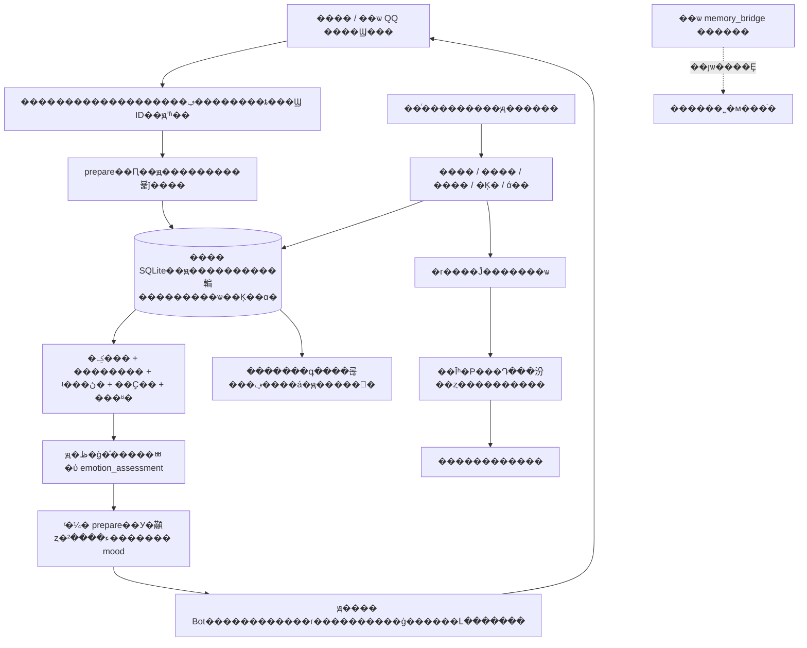

# Memory Bridge �� ���� AI ���������ϵͳ��Muse / Dot��

����ʹ�ñ��ع��ߵ�**���� AI �����壨Personal AI Agent��**һ��**�ɲ��𡢿ɼ������ɻ���**�ij��ڼ��䣺����������ļ�¼����ʱ����ԭ��������������ʵ�Ի��仯���Ķ���ʵ���ϣ�����ֵ�÷���ʱ������ϵ�û���

�ֿ�����������������

- **`personal_bot`��v0.3��**�����ؼ�����ļ����𹤾ߣ�������������������Dz�������ϵͳ����ڡ�
- **`memory_bridge`������ v0.1 Э�飩**����ѡ�ġ�������Ȩ�ļ��佻�����ߣ��ṩֻ�� MCP ��˽�� GitHub ͬ��������������������ϵͳ��Ҳ���Զ����� `personal_bot` �����ݿ⡣

> ���ǿ����в��������ϵͳ������ Muse / Dot �ٷ��������������Ҫ����Ӧ������ִ�С��ļ�����Ϣ����ʱ�����������������ȡ README �������ᰲװ�κ����ݡ�Muse ��һ��ʵ�ʻ�������֤��������·������ Muse / Dot �������밴������������ա�

**������һ�� Agent ��������ϵͳ���ȶ� [ϵͳ����˵��](docs/SYSTEM_REPLICATION.md)��** ������˵��ģ�������������������Ķ���40% �𲽵ı����ǩ���������߽�����ղ��衣v0.3 �ѽ��������ĸ�Ϊģ���ύ�ṹ�����������ٸ��ݡ�лл���ȹؼ����Զ���������������ڼ� [ģ������Э����Ǩ��](docs/MODEL_EMOTION.md)�����η����������µ� QQ ר�ô��룬Ҳ��������ֱ�ӿ�ƽ̨���ͱ���ͼƬ��ý����������

## ����˵������ AI ��ʲô

����Ŀ����**��פ�͸��� AI ������**�������ض��û����ڷ����ڿɳ�������״̬�ļ��㻷����ʹ�ù��ߡ���Ự�ƽ����񣬲�����Ȩ��Χ��������������� AI��Muse �� dot ����������̬ӵ���Լ����ƶ˵��ԡ��ļ����������

Meta �ٷ�ʹ�� [personal AI agent](https://about.fb.com/news/2026/09/introducing-muse-personal-ai-agent/)��OpenAI �ٷ��� dot ����Ϊ [always-on agent](https://learn.chatgpt.com/docs/dots)������פ�͸��� AI �����塱��������������������ϣ�����ͳһ����ҵ��׼���ࣻ�ƶ˵�����������̬���������и��������嶼��������Ķ������������[��������Դ](docs/TERMINOLOGY.md)��

## 30 �뿴���ܹ�



����Ĭ�����ڲ��𻷾��ı��ش��̣���������������ƶ˵��ԡ���Ŀ�����Զ��Ѽ����ϴ��� GitHub�����ظ�����ģ�͵ļ�����������������ƽ̨�����ݴ�������Լ��������ģ��ֻ���� `127.0.0.1:18765`�������˽�˼����͵��ⲿ embedding API������ģ������Ҫ���� Hugging Face��

## ����������

| ���� | ��ǰʵ�� | ��Ҫ����ı߽� |
|---|---|---|
| ���� | �¼�����ʵ��ƫ�á���ϵ����˼�����ܡ��������� `kind` �ֿ���������Դ��֤������ | ��˼/����/����������ģ�ͻ�����ʵ��Դ��������ȷ��Ϊ�ƶϣ��������׶������ݿ� |
| ���� | �ؼ��ʡ���ѡ��������������ʵ���ڽӣ��ٽ����Ҫ�Ժ����ʶ����� | ����ģ�����Ȱ�װ�����գ���ʱ�ص��ؼ���/ʵ����������ɨ���� 35ms Ԥ�� |
| ���������� | ���¼��鵵����ʽ����/�������ȼۺϲ�������������/�񶨱仯��ͻ��ʾ | �ϲ�Ҫ�о�ȷԭ�ġ���ϣ�������жϣ����Զ�������ͻ��һ��Ϊ�档˥���������ʶ����򣬲��Dz��ϸ�д������Ҫ�Է��� |
| ���� | ԭ�ظ�ģ�Ͱ��ﾳ�ύ v1 ������У�����ʵ�¼����� PAD ���ǩ���ޱ仯�������ˣ��޷�����˥�ڡ��ݵ�����ֵ��ѡ | ���IJ�����ģ�͡����������ؼ��ʶ��ף���������������ǰ���ã����DZ���״̬�ƶϣ��������ʵ�ж� |
| �������Ķ� | ���ź�ѡ����/ȥ�أ���������ʵ�ĵ��ֿ��Ķ���ԭ�����ƶϱʼǷֿ����ɹ����ƽ��α� | ����������ѡ���Ķ����Ϻ��ܽ�����������/ģ����ɣ������鹹���顢ˢ��Ƶ��˯������ |
| ʱ�� | ����ʱ�����ġ�����/����/����/���ڡ��Ƚ�������ѯ��ʱ���˵���ߵ�ԭ�� | ԭ���ӽ�����𲽻��ۣ����Զ�����ƽ̨ȫ�������죻Ŀǰ�� `Asia/Shanghai` ���� |
| ���� | ԭ��һ�������� + ʵ�ʵ����������������ҽӡ�ȡ�������ڡ��ָ���δ֪״̬���ط� | ƽ̨������ǰ���ѣ�������ֹ��ǰ���ӣ�ԭ������/�����Կ����ӳ٣����ܱ�֤�ͻ���׼����ʾ |
| ��������� | SQLite ���߿��� + ����/����/����/�α�/������ԭ���ļ�/�������񵼳������� 7 ���ɹ���ÿ�ղ�λ������Ŀ¼�ָ� | ����ƽ̨��ԭ���ļ�������Ҫʵ�ʵǼ�/��������ԭ�ļ����������°�װԭ������Ҳ���Զ��������� |

## ���ķ�ʽ���Ѳ������񽻸���Ļ�����

����������θ�**���Լ��ġ����б���ִ��Ȩ�޵Ļ�����**��

> ���Ķ� https://github.com/BrianChen33/memory-bridge-personal-ai-agent �� README �� DEPLOY_FOR_BOT.md�����ҵĻ����������� personal_bot ϵͳ���ȼ����ʵ�ʾ��е�����ִ�С��ļ����ȶ���Ϣ ID��ԭ����ʱ����������������ʹ�òֿ���Ķ�������Ŀ¼��������ԭ��������������߼���������ָ���ȱ��غϳ����գ��ٽ���Ϣ�ͷֹ����񣬱���ԭ�����ò�׼��һ��ָ����ˡ�����ģ�ͽ��������У�Ĭ�ϲ����� GitHub ����ͬ������Ҫ��ȱ�ٵ��������������ͨ��˵���Ѿ�����ɹ���ȱ��һ������ȷ˵����

������Ӧ�ü�����ȡ [DEPLOY_FOR_BOT.md](DEPLOY_FOR_BOT.md)������ֻ�������˵����û������/�ļ������ķ��ƽ̨�޷�������ʾ�ʰ�װ��ϵͳ��

## �ֶ����ٿ�ʼ�����ܱ��غ���

���� **Python 3.12**��������֧�� Python 3.10+��ֻ�ñ�׼�⣨SQLite ��Ҫ FTS5��������������Ҫ����������QQ ���������Ҫ Node.js��Linux ������·������֤��Windows ֧�ֱ��� CLI��systemd ģ������� Linux��

### 1. ��ȡ���벢������������

```sh
git clone https://github.com/BrianChen33/memory-bridge-personal-ai-agent.git
cd memory-bridge-personal-ai-agent
python -m venv .venv
```

�������

```sh
# Linux / macOS
. .venv/bin/activate
# Windows PowerShell ʹ�ã� .\.venv\Scripts\Activate.ps1
```

```sh
python -m pip install .
python -m personal_bot self-test
```

`self-test` ��һ������ʱĿ¼���кϳ���Ϣ�����������ʵ���䡢������Ϣ����������ʱ����Դ����Լ��·������������ա���

### 2. ��ʼ���ֿ��������Ŀ¼

�� `<STATE>` �滻�����Լ�ѡ���**����·��**������ Linux �� `/srv/personal-memory/my-bot` �� Windows �� `D:\PersonalMemory\my-bot`����Ҫʹ�����л����˵ļ���Ŀ¼����Ҫ�Ž���� Git �ֿ⡣

```sh
python -m personal_bot --root "<STATE>" init
python -m personal_bot --root "<STATE>" enable
python -m personal_bot --root "<STATE>" doctor
```

- `init` Ĭ�Ϲرչ��ܣ��ظ�ִ�б��������ļ����DZ�����ӵ�еķǿ�Ŀ¼�ᱻ�ܾ���
- `enable` �򿪱���ģ�飬**Ĭ�ϲ�������**���ⲻ�����Ѿ�ע��������Ϣ�ص���ʱ����
- `doctor` ��ʾ���������ԡ����ܿ��غ�������״̬��Ĭ�� `host=unverified`���������д�ɡ�ԭ�����ɳɹ�����
- ���á������Ķ���������������ͼ�Ͱ�װ��¼���� `<STATE>`���Ȱ� [��������ָ��](docs/DEPLOY_MUSE_DOT.md) ����ʵ��ڡ�

### 3. ��һ���ϳ��¼����ʵ�ʶ�д

��Ϊ��������һ������Ŀ¼��Ϊ `<STATE>`����Ҫ����ʽ��ע������ʾ�������� UTF-8 �ļ� `event.json`�����ݽ����ڲ��ԣ�

```json
{
  "op": "prepare",
  "scope": "owner-private",
  "text": "лл�㣬���˴�æ",
  "source": "synthetic:manual-demo",
  "event_id": "demo-001",
  "actor": "user"
}
```

```sh
python -m personal_bot --root "<STATE>" request --file event.json
```

��һ��Ӧ���� `event.status=captured`��`emotion.status=missing`�����鲻��лл���Զ��仯��Ԥ�������ĺ���������ǰ�ظ�ģ�������������������ʾ�У������ֶ���ͬһ JSON �������ºϳɽ�������ܣ�ģ��ģ���ύ��

```json
"emotion_assessment": {
  "version": 1, "changed": true, "label": "��ϲ",
  "delta": {"p": 0.04, "a": 0.02, "d": 0},
  "intensity_delta": 0.07
}
```

������Ϊ��������ֶμ��룬ע��ǰһ�ֶκ�Ķ��š��ڶ���ӦΪ `emotion.status=updated`���ٴ��ύ��ͬ����ӦΪ `replayed`�����ظ��ۼӡ���ʵ�Ի�����Ӳ���������ʾ������������ģ�Ͱ������ﾳ���ɣ����÷��ص��� mood ��֯�ظ������������ޱ仯�ŷ����������� [MODEL_EMOTION](docs/MODEL_EMOTION.md)��

��ʵ������봫����������ṩ����Ϣ ID��ԭʼ Unix ��ʱ�估��ȷ�����򡣵��Կ�����Ϣ�� `control=true`������ע����ʵ���� `synthetic=true`�����߶��������û�����/������Դ�������ϳ����ӽ����ڶ�����ʱ����Ŀ¼��

���� JSON ������ʾ���� [API ������](docs/API.md)�����м�����������г��������ݣ������µ�ϵͳָ�

## ��ѡ���򿪱����������

�ڴ˹��ߵĶ������⻷���ﰲװ������

```sh
# �ڲֿ�Ŀ¼���У����޸����������˵� Python ����
python -m pip install ".[embeddings]"
python -m personal_bot --root "<STATE>" model download
python -m personal_bot --root "<STATE>" model check
python -m personal_bot --root "<STATE>" model serve
```

�̶�ģ��Ϊ `Xenova/bge-small-zh-v1.5` ������ ONNX �汾��Ȩ��Լ 24MB���޶��� 5 ���ļ��� SHA256 �̶��� [model-assets.json](personal_bot/runtime/model-assets.json)��CLS �ػ���512 ά��ONNX ң���ڴ����Ựǰ���á�

`serve` ��ǰ̨��פ����Ҫÿ����Ϣ��������������һ�ն���������������һ��������

```sh
python -m personal_bot --root "<STATE>" enable --features events,time_query,emotion_events,reminders,vector,consolidation,reading
```

�ٷ���һ�� JSON ����`{"op":"vector_index","scope":"owner-private","limit":20}`������/�Ķ�����д���¼����������н��̨������

�����������������мල���Ƴ�פ��Linux ������ **��δ��װ** �� systemd �û�����ģ�壺

```sh
python -m personal_bot --root "<STATE>" model service --output personal-memory-encoder.service
```

��ֹͣ�Լ������IJ��� `serve`��ȷ�϶˿����ĸ�����ռ�ã������������߰�װ���񡣲�Ҫɱ�����ڱ��β���Ľ��̡�����Ҫ�������ȶ������� PID ���ڸ÷�������������������Ԥ�Ⱥ��ѯ���޼��ڴ��������ο�ʵ�������Լ 67�C123MiB��**��������Ļ���һ����ͬ**�����ú�����Ԥ�� 128MiB �����ڴ棬��Դ�����򱣳ֹؼ��ʽ�����

## ���������붨ʱ����

`<STATE>/state/scheduler-blueprint.json` ��**�����䡢Ĭ��ͣ��**�ļƻ�������һ��ͨ��ƽ̨���� API��������Ŀ¼�в�ͬ������ ID��������������ʵԭ������ע�ᣬ��ʵ�ʶ���ȷ�ϣ�

| ְ�� | ������� |
|---|---|
| ���� / ���� | ÿ 30 ���� |
| �������� | ÿ 15 ���ӣ�״̬��������ʵ��Ϣ���� |
| �����Ķ� | ÿ 2 Сʱ |
| ������ά�� | ÿ�� 03:35 |
| �������� | ÿ�� 04:10 |
| ����������� | ÿ 5 ���ӣ�׼��·�����ǵ�����ԭ�� runonce |

Ĭ�ϱ���ʱ�� 01:00�C07:00 ������̨���ۡ�������֪ͨ��û��ÿ�շ�����������ȷҪ��ҹ������ѿɵ����������¾�����ֻ�ܱ���һ�����ã������ʼ�����������ŽӼල����Ӧ����ء�

**�ָ�����ǰ��ȷ��ԭ�����Ѿ�ͣ����ع����ߣ���ֹ��̨����ͬʱ���͡�**

## �������ݡ��ָ��ͻ���

```sh
python -m personal_bot --root "<STATE>" backup --manual
python -m personal_bot --root "<STATE>" verify --snapshot "<SNAPSHOT>"
python -m personal_bot --root "<STATE>" restore --snapshot "<SNAPSHOT>" --destination "<EMPTY_DEST>"
python -m personal_bot --root "<EMPTY_DEST>/project" relocate
python -m personal_bot --root "<EMPTY_DEST>/project" doctor
```

�������ջ����� `state/deployment.json.host_manifests` ��ȷ���õİ�װ�嵥��ԭʼ `.bin`��������ֻ����ָ��ԭ����·����

`relocate` Ҫ�����д�������ռ�¼�Ĵ����ϣ������ذ󶨴��롢ԭ���ĵ����Ͱ�װ�嵥·��������Ŀ��ָֻ������ native ���ո��������ؽ�ͣ�õ�������ͼ�����رչ��ܡ������Ḳ��������ǰ�����裬Ҳ�����Զ�ע�����������ģ��Ȩ�ز����ݣ��ɰ��̶���ϣ�������أ�Python �����������°�װ��

Ҫ��ͣ��ǿ���������������嵥��

```sh
python -m personal_bot --root "<STATE>" rollback
```

���ʵ�ʹرձ��ؿ��ء����� epoch��**�������ݿ�ͺ�������Ϣ**����� `completed=false` �ǿ���ģ�����������ͣ�ñ�ϵͳ��ԭ������/ģ�ͷ��񣬲���������ļ��嵥�ָ��ⲿ�Ķ����û�����ִ�� [��������](docs/ROLLBACK.md) ���������ջ������ܰ�һ�� CLI ��ͣð��ȫ�����ˡ�

## ����������

```sh
python tools/test_all.py
python tools/check_wheel.py
```

����ԭ�����㡢��������ʱ�ع顢���� CLI����ͬĿ¼�ָ����ѡ QQ ���䡣Node δ��װ����ȷ���� Node ��飬Linux CI ��ִ�����Ӱ�ȫ���ԡ���Ӧ�Ӱ�װ��� wheel���ڲֿ�������һ�� `personal_bot self-test`������ֻ��Դ��Ŀ¼������

���ֿ��ԭ������������ʱ���������׶������ԣ����Ѳο�ʵ���ĺ�ʱ��һ�β��Գɹ�����ÿ�� Muse/Dot �������Ѳ����Ķ�/�賿�������Ȼ������Ҫ��Ŀ�껷�������۲죻��������Լ 95 ��ԭ���ɼ��ӳ٣����ܳ�ŵʵʱ���͡�

## �ĵ����

- [����ϵͳ���̣��ص�Ϊ�������������ظ�](docs/SYSTEM_REPLICATION.md)
- [ģ������ v1 Э�顢���׶ν����� v0.2 ����](docs/MODEL_EMOTION.md)
- [����������˵���������](DEPLOY_FOR_BOT.md)
- [Muse / Dot �����������������](docs/DEPLOY_MUSE_DOT.md)
- [JSON API���Ķ�����������](docs/API.md)
- [�ܹ�](docs/ARCHITECTURE.md) �� [�����߽�](docs/CAPABILITIES.md) �� [����](docs/ROLLBACK.md)
- [��ѡ�ɰ�ͬ���� MCP](docs/legacy/V01_README.md) �� [�� Muse ��ת����](docs/MUSE_ADAPTER.md)
- [��ȫ�߽�](SECURITY.md) �� [��вģ��](docs/THREAT_MODEL.md)

## ��Դ������

AGPL-3.0-or-later���� [LICENSE](LICENSE) �� [NOTICE](NOTICE)���ܹ��� [memory-brain](https://github.com/peterpoal134/memory-brain) �������������������Ѻ���� Muse ʵ�֣�ԭʼ�ļ���ϣ���������䷶Χ�� [provenance.json](personal_bot/provenance.json)���ⲻ����ԭ��Ŀ�� Muse / Dot �ٷ����顣�����ֿ�ֻ�ų���ͺϳ���������ʵ����ʼ�����ڸ��������Լ��Ļ�����
