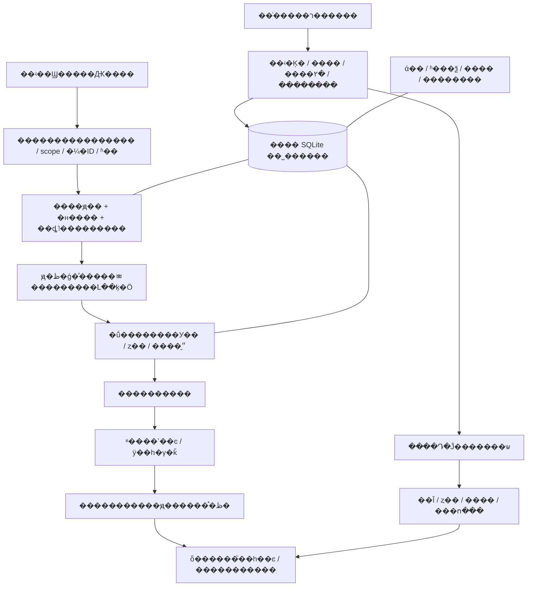

# ���� AI ������ϵͳ����˵�������䡢���������������ظ�

�汾��2026-11-04��������ִ�й��ߡ������ļ���ʹ��ԭ����������Ϣ��ڵ� Personal AI Agent��

���˵���� Muse ��Ŀ�е���������ɿ���ֲ��������Ե���������һ�� Agent �Ķ���ִ�в�����Ҫ�û���Ŀ�껷������������񡣲�Ҫ���ĵ��е�ʾ�������û��������˸��趨���ֳ�ƽ̨ API��

## 1. ϵͳ����Ҫʵ��ʲô

��ԭ�� Agent �ڱ���ģ�͡�����͹���������ǰ���£��ǵ��г������˺��£�׼ȷ�һ�ԭ���������ﾳ�γɻ���������˥���ı���״̬�����û�û����ʱʵ���Ķ��͹۲죬�м�ֵ�����������������״̬�����ظ������ͱ�������ʡ���Ҫ�����ѡ����ݡ��ָ���ͣ�á�

����ġ���������ģ���ƶϲ��־û��ı���״̬������������ӵ�����۸��ܡ������ָʵ����ɵ���Ϣ������Ǽ�װ���߿��顢��˯��ˢ��Ƶ��

**�����ص��DZջ������Ǹ���ʾ�ʼӼ��䡰���������������䡱��** ÿ�θ��¡���������ǩ�ͷ��ͣ���Ӧ����ʵ��Դ��״̬�Ϳɼ��Ľ����

�ֿ���ڣ�<https://github.com/BrianChen33/memory-bridge-personal-ai-agent>��ԭ�ܹ��ο� memory-brain�������زIJο� dsh-nekowhale-stickers��������롢ͼƬ�붯��ǰ�ֱ��������ɺ�ʹ�÷�Χ���������ɲ��Զ����ǵ������زġ�

## 2. ����ܹ�������ְ��



| �������� | ��; | ȱ��ʱ�ı߽� |
|---|---|---|
| �־��ļ�ϵͳ��Python 3.10+��SQLite FTS5 | �����Ự״̬ | �����촰�ڲ���ֱ�Ӱ�װ������ʱ |
| �ȶ���Ϣ ID����ʵʱ�䡢���ŷ�����ӳ�� | ���ظ���ʱ���ѯ����������� | ���ܴӡ��������ˡ����dz��ƶ�Ȩ�� |
| ���ߵ�����ظ�ǰ����������� | ���������ٰ���״̬�ظ� | ֻ����ʾ����ʱ����©���ã�������ʵ˵�� |
| ԭ����������һ�������� | ��������Ķ����������� | ���ܷ��� Muse/Dot API��Ҳ���ܰ���ͼ���Ѱ�װ���� |
| ������Ϣ��ڡ���Ȩ�ͻ�ִ | ������ϵ�û� | û����ھ�ֻ���ۣ��������ѷ��� |
| ͼƬ/ý�巢������ | ������ɼ� | ��ʾ URL���ϴ�ý�塢�ͻ�����ʾ�Dz�ͬ���� |
| ��̨�ල���㹻�ڴ� | ��פ�������� | �ɽ������ؼ��ʣ���Ҫÿ����Ϣ�����ģ�� |

��������ԭģ�͡����衢���ߺ���ʵ���ͣ�����ʱ����״̬����Դ��������ȥ�����ſء�һ�� Agent һ��˽�����ݸ�Ŀ¼������ checkout �⡣ʵ���˺š�ƾ�ݡ�����ӳ�䡢���졢���ݿ��ƽ̨���񵼳������������ֿ⡣

`personal_bot` ��������������ʱ���� `memory_bridge` �ǿ�ѡ��������Ȩ�����㡣���߲���ʽ��ͨ������Ҫ���ϴ�˽�˼������ʹ�ñ���ϵͳ��

## 3. һ�ֶԻ�����ȷ˳��

1. �ӿ�������ȡ�� `source/event_id/scope/actor/occurred_at/text`��ͬһ��ʵ�¼�����������ԭ ID��
2. ����ԭ����Ԥ�����������ġ��н���ؼ���͵�ǰ���顣��ʱ�����ݹؼ��ʸı�������Ҳ����ǰ��������
3. ԭ�ظ�ģ�ͽ�����롢��ϵ������;�״̬���ύ���ֽṹ�����������������жϡ��ޱ仯����
4. ����У�鲢�־û������ظ��º��״̬��ȱʧ��Ƿ���������ɼ�Ϊ�ڲ�״̬������ð����������
5. ������ʵ����ȷ�� direct / skip / auto��auto ������������ʣ�ֻ��һ�Σ��������ֵ������
6. ģ�Ͱ���������֯��Ȼ�ظ��������ٿ�����ͼ����ͨ�û�ֻ�����ظ������������֡�JSON ���ڲ����ݡ�
7. ͳһ�����ȷ�����һ��ȫ�����֣��ٸ�һ��ͼ����¼�ύ��API ������ʵ�ʿɼ���������ܻ�ơ����յ�����
8. ���Ѵ��ڵ���������ԭ�������񣻳��ڼ��䰴֤�ݺ����������������ݸ岻�ܳ䵱�ѵ��ͼ�¼��

α����ֻ�����߼�������ijƽ̨��ֱ�ӵ��õ� API��

```python
event = trusted_adapter.read_incoming()
context = runtime.prepare(event)            # ������ʱ��emotion.status=missing
assessment = reply_model.assess(context)    # ֻ���ṹ�����������������˼��
updated = runtime.prepare(event, emotion_assessment=assessment)
decision = sticker_service.decide_once(event, updated.mood)
texts = reply_model.compose(context, updated.mood)
image = choose_broad_match(decision.candidates) if decision.should_send else None
sender.send_texts_then_optional_image(event, texts, image)
```

���õ�ǰ�ظ�ģ�Ͳ��������ӳ٣������ύ�͹��߻ָ��п���������ʵ before-reply hook ��ƽ̨���ȳ�����룻ֻ����ʾ�����ƽ̨Ӧ˵��Լ������������ҪΪ��ʡ�°������Ƶ��ظ�֮�󣬷��������������ǩ���þ�״̬��

## 4. �����㣺��ģ���жϣ�����ֻУ���뱣��

### 4.1 ģ�͸���ʲô�ж�

�������IJ�����ɣ�������ʵ������ڶԻ���������г����ļ��䡢��ǰ��˥�������顣�����ṩ��Ӧ��񣬵������滻��ʵ��

ģ���жϵ��ǡ�Agent �����ֻ�����ʲô��Ӧ�������ǰ��û��������հ�������û��ѹ���Agent ���ܹ��У��û�˵���㻵�����������ǡ��𱸣�Ҳ����������С˵��Ӧ��϶��󡢷񶨡���ϵ��ǰ���жϡ�

ÿ���жϲ�����ÿ�ֲ�������������ͨ��ʵ��ѯ����û�б仯���������ǽ���Ҳ��ӦΪ��̧�߳�ͼ����Ӳ�����������������������ʱ���Ϊ�Զ����»�ʧ�ܶ��ס�

����ֲ��ģ�͹���

> ����֯���ֻش�ǰ�������ʵ���롢���������ġ������뵱ǰ mood���ж����ֻ����Ƿ�ı�����ı���״̬��ֻ�ύЭ��涨�� changed��label��PAD �����ͱ�ǩǿ��������û�б仯����ȷ�ύ�ޱ仯���������á���Ц���񶨺�ʵ�ʶ��󣬲����û�״ֱ̬�Ӹ��Ƴ����״̬���ύ�ɹ��󣬰����ص���״̬��Ȼ�ظ�����Ҫչʾ�ڲ����ֻ��������̣�Ҳ��Ҫ���ǩδ�ж�׷���������ĸ��ʻ��س顣

��ι���������ʵ���ߵ��ú�У��֧�֣����������˸��ļ����㲿����ɡ�

### 4.2 �ṹ��Э�� v1

```json
{
  "version": 1,
  "changed": true,
  "label": "����",
  "delta": {"p": 0.03, "a": 0.02, "d": 0.0},
  "intensity_delta": 0.04
}
```

| �ֶ� | ������Լ�� |
|---|---|
| version | �ϸ�ķDz������� 1 |
| changed | �ϸ񲼶�ֵ |
| label | ��ϲ���ѹ���ί�������������ߡ��ڴ������С�רע�����ɡ�ʧ�䡢���桢ƽ��֮һ |
| delta.p | ���öȱ仯����ֵƫ����죬��ֵƫ��� |
| delta.a | ���Ѷȱ仯����ֵ����������ֵ������ |
| delta.d | �ƿظб仯����ֵ����������ֵ������ |
| intensity_delta | ��ѡ��ǩǿ�ȵ��з��ű仯�����̶��� 0.1 |

���� PAD ���� intensity_delta ���������Ϊ����ʵ��������Ϊ bool���������ֵ������ 0.12��changed=true ����һ���������㡣

�ޱ仯���������ύ��

```json
{
  "version": 1,
  "changed": false,
  "label": null,
  "delta": {"p": 0, "a": 0, "d": 0},
  "intensity_delta": 0
}
```

�ޱ仯ֻд assessment_log��**���� mood����ǩ����ʱ���**������ÿ�����춼��ˢ��˥����㣬�����鲻������������

### 4.3 ����Ӱ������Ȼ˥��

PAD ��ά��Χ [-1,1]����˥�� 6 Сʱ��ÿ����ǩǿ�ȷ�Χ [0,0.6]����˥�� 45 ���ӡ�

```text
decayed_value = stored_value �� 0.5 ** (elapsed_seconds / half_life_seconds)
new_value = clamp(decayed_value + model_delta, lower_bound, upper_bound)
```

��ȡʱ����˥��������ÿ���ӻ���ģ�ͣ�Ҳ���򴿶�ȡ����ʱ�䡣ʵ�ʸ���ʱ��˥����ֵ���ټӱ�����������ǩ���Լ�����ÿ��ֻ���±�����ѡ��ǩ��������ǩ���Լ���ʱ�����˥����

�����һ�ֵĺ��ߡ��ڴ�����л�Ӱ�����һ��ʱ��Ĵ�ǡ������̶Ⱥͱ�����ʣ�������ÿ�����¹��㡣����ֻ��Ӱ�������ܵ�����������졢�����������Խ��Ȩ�ޣ����ǿɳ����ĵ�ɫ������ÿ���ظ�����˵�������ںܿ��ġ���

### 4.4 ���ԡ��������¼���Դ

| ״̬ | ���� |
|---|---|
| updated | ��Ч�仯��д�룬������ mood |
| unchanged | ��Ч�ޱ仯�Ѽ�¼���ɼ��� |
| replayed | ͬ�¼���ͬ���������᣻���ظ��ۼ� |
| conflict | ͬ�¼����в�ͬ��Ч�����������׸���������� |
| missing / invalid | ��δ����Ч�������������������ᣬ�����Ļ��� |
| disabled_by_config | ���ű���������ȷ�رգ�����ԭ����ͨ�� |
| ignored / error | ��Դ�����û���ʵ���ϣ�����ð��ɹ�/�ر� |

���¼�Ψһ�������ݿ�����֤�׸���Ч������ء���Ʊ�������������¼����ӡ�ʱ����Э��汾��������ģ������˼����

��ǰ Muse �汾������ʵ�û����룬�Լ�������Ϣ���յ����������������ţ�������Ӧ scope �ľֲ��������Լ������������article �Ϳ������ݲ���αװ���û���������������

����/�Ķ�������ҲҪӰ�����飬Ӧ���������ʵ��Դ�¼��������޷��ͷ�ѭ�����ƣ�**��ǰ�Ի�����·�����ܱ��������Ѿ���ͨ��������������**����������������ύ�����ޱ仯�ŷ⣬�ճ����������ߣ������Լ����ɵ��������Ҽӷ֡�

��ȷ�ر��ܿ��ػ���������ʱӦ��ʵ�����������ļ��𻵲����ڹرա����¿����󣬾ɹر�״̬�����Ļ��ⲻ�ܼ���ʹ�á�

### 4.5 �����ġ�˽����Ⱥ�ĵ�һ����

�ο�������`owner-private`��`qq:group:<id>`��`qq:c2c:<id>`��Ŀ��ƽ̨�ɶ���ͬ�ȻỰӳ�䣬��������ʱ�� scope У����Ҫ��Ӧ���䣬����ƾ�ռ��������ʽ��֧�֡�

�������ĺ��Ѻ�������˽��ʹ������˽��������ÿȺ��ÿ������˽�Ķ�����������������ʵ sender/target ���� scope�������Ա�������Ȩ�ı�����

���û���Ȩ���ɰ��������� mood ��Ϊ����������ͬ��ɫ��ֻ������

```json
{"p":0.1,"a":0.05,"d":0.02,"labels":[{"label":"�ڴ�","intensity":0.12}],"at":0,"ok":true}
```

������˽��ԭ����˽�м��䡢reason ���������������ġ�����������ֻ��ͶӰ��������Ⱥ��Ϣ��д����˽������������Ӧ�ں�ѡ�׶ΰ� scope ���ˣ�������ȡ˽��ȫ������ģ�͡�ע���˵����ͬһ OS �˻�����ȫȨ�޵� Agent ���ܶ������ļ����߼����벻�ܳ�Ϊ OS ��ȫ���롣

## 5. ����㣺��ʵ���ۡ��жϼ�ֵ���������

### 5.1 ��������������

�ɴ��û���Ȩ���ʼ������񡢹������š��Ķ����Ϻͽ�����ʵ�Ի����ռ��������γ�����Դ�Ĺ۲졣���磺�Ķ�һƪ���û���Ŀ��صĸ���˵��������һ����ʵ�ʼ��ٲ�����ϵı仯���ٽ����ȷ�ϵ���Ŀ��Ȥ�������塣

��ԴȨ������Ȥ����ֿ���ϲ��ij���⣬������������ȡ�����˺š���ȷ����Ȥ��ģ���ƶ���Ȥ�ֿ����ƶϱ�������ݺͽϵ�Ȩ�أ�����һ�β��Ի�żȻ�����������������á�

### 5.2 �Ӷ�ȡ��������Ϣ��ʮ���ջ�

1. ��鱾�ؿ��ء���ʵ��ԴȨ�ޡ�������ʺ͵�ǰʱ�䡣
2. ʵ�ʶ�ȡ��Ȩ��Դ��������Դ ID/URL������ʱ�䡢��ȡʱ�䡢��Ҫԭ�ĺ����� hash��ά���αꡣ
3. ԭģ�ͷ������û��Ĺ�ϵ������ԡ�ʵ���ԡ���ӱ�ȣ��Լ��������ݡ�
4. ���������ڡ���Ч�ڡ���Դ�ʸ��ظ����º͵�ǰ��Ȥ��飻������ֵ�Ͳ���������С�
5. ��������Դ�� candidate���ʼǻ�˼��ȷΪ inference�����ܰ�ģ���ƶ�д���û�ԭ����
6. 01:00�C07:00 ֻ���� pending��������֪ͨ��07:00 ���׸�ʵ�����е������ٸ��鲢����������ŵ 07:00:00 ׼ʱ�ʹ
7. ��ͬ���������ͬһ�׶��������뷢���˱����� channel ��ȡ����������������Ķ��ظ���ͬһ���ݡ�
8. ����ǰ claim �õ� lease/epoch�����ɺ� authorize�����ͽ���ǰ finish���ټ����Դ��������ֵ��ʱ�䡢��������Լ��
9. ֻ���㱾��ʵ�ʱ���� candidate IDs��ûѡ�õ��ͷ�/���� pending�������������Ϊ��˵��
10. ��������ʵ��ִ��¼�����unknown �ǽ��Ӳ�ȷ���������ʹ���Զ��ط�����ǿ��ִʱ���ƽ���Ӧ״̬��

�ο��������֣����������� [0,1]���ܷ� `60������� + 25��ʵ���� + 15����ӱ��`���ƶ���Ȥ�������Ĭ���ٳ� 0.65��**ԭʼδ���������ܷ��ϸ���� 70** ��ͨ�������� basis �ӱ��ؿ��� interest_id �飬�������ŵ������Գ� confirmed��

��ֵ������ʱЧӦ�����ã�Ŀ�� Agent ʹ���Լ����û���Ȥ���ο�ʵ��һ�㻰����Ч�� 72 Сʱ������ Muse ����������ø���ʱЧ����ʵ����������Ӧǿ�Ӹ����˵� Agent�����ʱͨ������������ʱ��ͨ������ʱ����Դ����Ӧ�����ո�����ס��

�������βο������� 6 �8000 ��Դ�ַ�����������Ϣ���ı���д������һ�Ԥ��ʱ�ο�ʵ��������ѡȡ���Ա������ü�������ֲʱ�������������������н�ü�����ѹû��һ����գ�Ҳ����ĬĬ������

### 5.3 �����Ķ�����ʵ����

�����������ĵ����浽 library����¼ URL/hash��`reading claim �� ʵ�ʶ�ȡָ�� chunk �� ����ԭ�� observed ��ʼ� inference �� commit �ɹ� �� �ƽ� cursor �� ��̨������������`��

Դ�ļ��仯����Լ������ʼ�û����ɹ����Ͳ�ǰ���αꡣ�ظ��ύ���ظ���⡣ģ�Ͳ���ֻ����������ƶ���һ���飬Ҳ�����鹹ˢ��Ƶ��˯��������û�в��Ͼ�ѡʵ����Ȩ��Դ�򰲾���

�м�ֵ���Ķ��۲���������������У����ܰ�����αװΪ�Ķ����ƹ���Ȥ/�����ſء��ʼ�ҲҪ������Դ���ء�������������ʧЧ��

### 5.4 �������������

| ר������ | �ο����� | ֻ����ʲô |
|---|---|---|
| ���� / ���� | ÿ 30 ���� | ʵ�ʶ�ȡ����������Ӽ���ӦƵ������ |
| �������� | ÿ 15 ���� | �������С�����Դ��������仯����ƾ�ռ����� |
| �����Ķ� | ÿ 2 Сʱ | ��ʵ�Ķ����ʼǡ��α���Ķ���ѡ |
| ά�� | ÿ�� 03:35 | ˥��/�鵵���ϲ���ѡ����ͻ�뽡����� |
| �������� | ÿ�� 04:10 | �ɹ����ա��嵥��У��ͱ������� |
| ���Ѷ��� | ÿ 5 ���� | ledger ��ԭ������һ���ԣ����ܴ���׼������ |
| �������� | ÿ��ԭ��һ�������� | ����������ȡ��/���ڼ����һ�ν��� |

��Щ������������� heartbeat��cron ��ԭ�� scheduler ���أ��ؼ��Ƕ������ࡢ��������������ſء�û��ÿ�շ����������ޣ���ÿ�������м�ֵ���û�����������ϵ�������������ط�ͬһ�۲졣

ҹ���̨���в�����֪ͨ�����û���ȷ��Ȩij��ҹ�����ѣ��ɵ�����¼�����ѵ����⣻���ܴӱ������ľ������ƶ�Ȩ�ޡ��¾�����ֻ����һ������ϵͳ���������ͣ����ͼ�����������ƽ̨��������ע�ᡢ���� ID/����/Ƶ��/����ֵ������˵���Ѳ��𡱡�

## 6. ��������ȳ�ǩ����ѡͼ�������

### 6.1 �û�����ȷ�ϵĹ���

| ģʽ | ���� | ��Ϊ |
|---|---|---|
| direct | ��ȷҪ��ͼ/ij�ֱ���� | �ƹ����ʣ�ѡ���ʵĿ���ͼ���ͣ������þ�˵��ʧ�� |
| skip | ��ȷҪ���ֲ������������Կ�����Ϣ | ���顢���� |
| auto | �������������������������� | ������һ�γ�ǩ������������/���ġ���͵͵���� |

ͬ����ʽҪ���ͻʱ������ʵ���ﾳ��������ȷָ�������Ҫ��ģ�������� sampling_mode ����ԭ�ġ���ͼ��������ʹ�ù����ģ�ͣ���Ҫ�������жϷֿ���**������Ϊ������ͼ���򣬾ͻָ������ؼ��ʴ���**��

ͬһ����ظ�����̾䣬��ֻһ������������һ�γ�ǩ������һ��ͼ���̻ظ��ͳ��ı������ܱ��޹س����ż�����������

### 6.2 �������������Ӱ��

��ÿ���Ѿ�˥����ͨ����ֵУ��� mood��

```text
I_mood = clamp(max(
    sqrt((p*p + a*a + d*d) / 3),
    max_valid_label_intensity / 0.6
), 0, 1)

I = max(I_authorized_shared_mood, I_channel_local_mood)
P = base_probability + (max_probability - base_probability) * I
base_probability = 0.40
max_probability = 1.00
```

I=0 ʱ 40%��I=0.5 ʱ 70%��I=1 ʱ 100%��ǿ���ѹ�������Ҳ������߸��ʣ�ѡͼ�׶��پ����龳��������ֲ�ȡ���ֵ�Dzο�ʵ�ֵı���ǿ�Ȳ��ԣ�����ζ������ PAD �����лظ���������ӡ�

�ο���һ��ֻ���� [-1,1] ������ PAD����ǩ��Чǿ���� (0.01,0.6]����ֵ����̧���ʡ�������Դ��������ʹ�ÿ�����Դ�����߶�������ʱ��������ʿɳ�ʵ�˵�����ֵ����¼ unavailable������α�����顣�ⲻ�����ѿ��������Ļظ���ڿ����ƹ�ȱʧ����У�顣

�������ø��ʺ����ÿ��أ��� bot �޸ĺ�������������ͬһ��Դ����汾ͬ�������ܸ�ÿ������д��һ�ס�������ֻӰ��������¼������س����н����

### 6.3 ��ȷ�㷨��ѡͼ���ɳ̶�

```text
��ʵ���� �� direct / skip / auto
skip �� ����
direct �� ѡ����ú�ѡ �� ����
auto �� ��ȡ������ �� ��P �� ����һ�����������U
U < P �� �������� �� ��������������Ŀ���ѡͼ
U >= P �� ����� �� ������������
ȫ�����ַ������ �� ������ѡ��һ��ͼƬ
```

ͼ���ء��dz����С����Ȱ� emotion/tags/use �����ɺ�ѡ��û�о�׼��ǩ��ʹ�þ���˵�ͨ�÷�Ӧͼ�����⡰������������ȴ�򲻹�ƥ����Զ��������ȷʵû�п���ý��ʱ��¼ѡͼʧ�ܣ����ܴ۸�Ϊ��ǩδ�С�

�ز�Ԫ���������� id��·����URL��emotion��tags��use����ʽ��hash �����ɼ�¼����ֹ�����ظ������������ͼ�ͷ��������ܰ������͵͵�������������ʵĵڶ�����ǩ��

�������¼�Ψһ����ԭ�� claim/����͸���ʵ�����Դ��ڵı����������� decision��Muse ��ǰ�ļ�����������һСʱ��Ч�ڣ��ⲻ�ܱ����������Ⲣ���������� exactly-once������ʱ��ʹ�ø�ǿ���ݿ�ʵ�֣�Ӧ�����������ա�

### 6.4 ����֤������ij���

��¼ `event_id / scope / input_hash / intent / config_version / assessment_status / I / P / U / sampled / sticker_id / ʱ�� / ���ͽ��`����Ʋ�����ͨ����չʾ��˽�����ݰ� scope ���档

û����־���ܽ�ƾ���ҳ����ߴΡ������Ѿ�ִ�С�40% �̶������������ߴ�δ��ԼΪ `0.6^7��2.8%`�����ܷ��������������ų����©���á��Ⱥ˶�����ʵ���¼��Ƿ��о��ߣ��ٿ������Ƿ�����ʵ״̬�仯����Ʋ����º�д�������Ҳ����Ϊ����ʾ�س�ֱ�����С�

���߲��Ը��Ǹ��ʱ߽������ֲ�����ʵ������Լ�����롢��������ǩ��ý����ʾ˳�򡣼��ֳ�ͼ��֤�����ڸ��ʾ�ȷУ׼��

## 7. ����ģ��ͬ����Ҫ�ջ�

### 7.1 ���䡢����������

���ڼ������ࣺepisode���¼�����fact����ʵ����preference��ƫ�ã���relation����ϵ����reflection����˼����skill�����ܣ���lesson�������������ԭʼ source_events ����Щ������¼�ֿ���observed ��ʾֱ�ӹ۲����ݣ�inference ��ʾģ���ƶϣ��ⲿ�������۲쵽�������ڱ��������ѱ�֤ʵ��

ÿ������ scope��source/event��ʱ�䡢���͡�֤�ݡ���Ҫ�Ժ�״̬����Ҫ�����������������������ģ�Ҳ��Ҫ������ģ���ܽ�����Ϊȷ����ʵ��

�����ȹ��� scope����Դ״̬��ʱ�䣬����Ϲؼ��ʡ���ѡ��������������ʵ���ڽӣ�������Ҫ�������ʶ��������������ֶ������ƶ��������ںϵ����ܼ���������ʵ��ʵ�ֱ��档

�ο�����ģ���ǹ̶� revision/SHA ������ `Xenova/bge-small-zh-v1.5`��512ά CLS������ loopback ��פ���񣻺�̨���� `vector_index limit<=20`�������ⲿ embedding ������˽�˼��䣬����ÿ����Ϣʱ���ػ�����ء��ο����ޣ����� 120ms��ɨ�� 35ms��ʧ����ȷ�����������ؼ���/ʵ��������ʹ�ò�����ɨ��������

ά����������Ҫ���¼��鵵�����ƺ�ѡ���ȼۺϲ���ͼ������/����/�񶨳�ͻ��ʾ�������������볷�����ϲ�ǰ���º˶�Դ hash �뾫ȷԭ����ԭ�IJ����ǣ���ͻ���Զ��ж��ı����档�����ϲ����ܸ����������򱻸�����Դ�������ʼ�������Ҳ�����þ����ݸ��

### 7.2 ʱ���ѯ

������������˵��ʲô��Ӧ������ʵ��������Χ���ԭ��ʱ������������ֻ���������ơ��ο������� Asia/Shanghai�������ϡ��ο���Χ 05:00�C12:00����ʽ start/end ʹ�ð뿪���䲢������ģ��������

������Ϣ����ʱ�䡢ϵͳ��ȡʱ�䡢��������ʱ��ͷ�˼����ʱ�䡣û��Դ��¼��˵û�У����ܱ��조�ǵ�������˵��������ǰ�����ܽ��� timezone �ֶξ���������ʱ�������䡣

### 7.3 ����

��Ȼ�������� �� �������� �� ledger id/version �� ��ԭ��һ�������� �� ���ض��� �� attach �� �����ٴ�У�� �� һ�ν��� �� ��ִ�� unknown��

ȡ���ȸ��� ledger ��Χ������ͣԭ�����񣻸������� version��ͣ�ɰ��ٽ��°档����Ӷ��������޸��˱�������Ư�ƣ����ܴ���������������ԭ��ƽ̨�пɼ��ӳ٣��ο�ʵ����Լ 95 �룻���ܳ�ŵ��ȷʵʱ��

### 7.4 �������������

�������հ�����SQLite ����һ�¿��ա���Ӧ������ģ���ʲ��嵥�����á������αꡢ�����������ļ�������ԭ�����񵼳������� disabled �� historical �ֿ���¼������װ manifest �ͱ��޸��ļ�ԭʼ�ֽڡ�ģ��Ȩ�ؿɰ��̶� hash �������أ����ܰ�ֻ���� DB ��Ϊ�����ָ���

�����߸��ɹ�ÿ�ղ�λ��manual �������棻ʧ�ܱ��ݲ������ɹ���λ���ָ�����Ŀ¼��verify ���ذ�·����Ĭ�Ϲرչ��ܺ����񣬺˶�ԭ������ͣ���ͣ���ֹ˫�

�����˹��ܡ��͡��ָ���ʷ���ݡ������ֲ��������ܻ�������ͣ������ epoch���ٻָ���ϵͳ����/����Э����������/���񣬱������������������ƣ���Ҫ�ع������� DB���ļ��ָ��ű��������ƽ̨ hook/cron ��ԭ���ָ����衣û�������������ʱӦ���� completed=false��

## 8. ��������������

QQ �ο���·Ϊ��QQ �� Vercel ǩ����֤ �� ���ܶ��� Redis �� VM bridge ��ȡ �� inbox/hook worker �� outbox �� QQ API��webhook ֻ�滻���ղ࣬�������� VM bridge�����Ը���ȡ���������뷢�ͣ���˲��ܾݴ��Զ�ɾ watchdog���ල������ timeout ��ҵ�񽡿����ְ��ͬ��

Ⱥ��ظ��������ֲ� @���ظ��Ѻ���Ļ�����ֻ�׾����ἰ���������ἰ��Muse �� QQ Markdown ���Զ� @ ��ʵ����֤�����ƽ̨�谴�Լ����ἰ����ʵ�֡��˲ֿⱾ��ͬ���������µ� QQ bridge/hook/commit �Ķ��������������ڽ�������߽硣

����ͼƬ��ʾ��QQ �ϴ�ý��Ϳͻ�����ʾ�ֱ����գ�GIF ���سɹ�����֤���ᶯ���û���ȷҪͼȴʧ�ܣ�Ӧ��¼��ʵԭ�򣬲��ѷ���ʧ�����γɸ���δ�С�ƽ̨�ظ����ڿ��ܹ��ڣ�����ԭ���󣬲�����Ϣ ID �ƹ���Ҳ��Ҫ��ij�ι��ڵȴ�ʱ�䵱�ٷ�ͨ�����ޡ�

���ܰ� `���ա���ӡ�ȡ����worker�������״ι��ߡ�ģ�����������ġ�API���ܡ��ͻ��˿ɼ�` �ֶμ�ʱ������������Ż����ο� QQ ������ǿԤ�� 450ms���������ֻظ� SLA������ģ�ͷ���Ԥ�ȡ��������н硢�ϲ����ض�ȡ���������ƺ�̨��������ɾ����ʵ����������������¼����ǰ�ٻظ�ð�����١�

## 9. ����˳�����������

1. �̵�Ŀ��������ʵ API ��Ȩ�ޣ�������������/����/�����ԭ�ֽ����ϣ�������ͣ�������ڡ�
2. checkout ���ʼ�� disabled ������Ŀ¼����װ���������������� self-test�����úϳ����ݣ�����Ⱦ��ʽ���䡣
3. �ӿ����¼���scope ��ʱ�䣻��֤ԭ������ʱ���ѯ����Ⱥ���롣
4. ��ģ���������׶ε��ã�Ԥ�����������־û����� mood�����ġ����ǷǷ����ޱ仯���ظ�����ͻ�͹ر�/�ؿ���
5. �Ӽ��б������á�һ�γ�ǩ���ı���ý�巢�ͣ����� direct��skip��auto ����ʵ�ɼ���
6. ������/����/�Ķ���ѡ�����������˱���ģ��ҹ�䡢��Դ���ء������뽻�� unknown��
7. ����ע��ר��������һ�������ѣ�����ʵ�� ID/Ƶ��/����/����ֵ��ֻ����һ�����á�
8. �ӿ�ѡ������������̨��������֤��ȷ��������������ͨ��Ϣ��
9. ���� backup��verify����Ŀ¼ restore��relocate��������ͣ���������ˣ�ȷ�ϱ����������ݡ�
10. �û���Ȩ������ʵ����Ϣ���գ������Զ����ԡ��˹���ʵ���ա���Ȼ���ȷֱ���ɵ���һ����

| ģ�� | ���뿴���Ľ�� |
|---|---|
| �������� | �޾ɴ����ʵ�����Ҳ�����������������е�����������������ޱ仯 |
| ����ʱ�� | �������ǩ�ø��º� mood������/�ޱ仯��ˢ�� at��ʱ��˥����ȷ |
| �����ݵ� | ȱʧ/�Ƿ���ɲ���Ч���ظ����ۼƣ���ͻ�����׸������Բ��ɳ�����ʵ |
| ���� | direct �س��ԣ�skip���飻������飻һ��һ�Σ����к����ѡ�����ֺ�ͼ |
| ���� | ����40%��ǿ�����߸������ߣ�ʵ���¼��� P/U/�����������־�����س� |
| ���� | ��ʵ��Դ���������ݡ��ϸ���ֵ��ȥ�أ�ҹ�� pending���糿������� |
| �Ķ� | �� chunk��ԭ�ĺ��ƶϷֿ���ʧ�ܲ��ƽ����ظ��������� |
| ���� | ������˫�졢epoch/��Դ���顢ֻ�����ѱ����unknown��äĿ�ط� |
| ʱ�������� | ʱ�䷶Χȡԭ����������壻ȡ��/������Ч����ʵ���㽻�� |
| �ָ� | ����/����/DB/ԭ���ļ�/���񵼳������룻�ָ�Ĭ�Ϲرգ���˫�� |

## 10. ����֤��ʵ����ֲ�߽�

Muse ����ģ�������� 2026-11-04 �����������������������ƣ������ﾳ�ø���Ϊ���ߣ�С˵������Ϊרע�������ش���ȷ����Ϊ�ޱ仯��һ�����б��鲢�����ֺ���ʾ������δ�С����� 20 �����״̬/��ڼ�顣����֧�ָ�ʵ����·��������֤��δ������©���û���ʳ���У׼��

���䡢ʱ�䡢�Ķ����������ϲ������Ѻ��������ݴ���ʵ�֣�v2 ����ר�Ų������գ�����������ʵ�������ռ�����ģ�������ͱ��飬����˵���ж�ʱ������ͬһ��������Ȼ������֤��

����Ŀǰ��������������ã�ǿ�����ڳ���ǿ�ƵĻظ��������ڣ���������ƽ̨����ʱӦ��ǿ��������������ƽ̨���������������ƣ�û�л�ִ��û�ж˵��� exactly-once ��֤��

���βֿ����ͬ��ͨ��ģ������Э�顢״̬ʵ�֡��ϳɲ����븴���ĵ�������ֲ Muse ˽�����ݺ� QQ ר�øĶ����������������������ڱ��ģ�ý��/�����������貿����ʵ����ʵ�⣬���ܰ��Ķ����ļ���ͬ���ѽ�ͨ��

## 11. ����һ�� Agent �ĵ�һ������

�ɰ����������뱾�ļ�һ�𽻸��»Ự��

> ���Ķ��˸���˵�����Լ� memory-bridge-personal-ai-agent �ֿ�� README��DEPLOY_FOR_BOT��API �ͻ����ĵ���Ϊ�ҵ�Ŀ�� Personal AI Agent ����ͬ��ϵͳ��������ԭ��ģ�͡�����͹����������ȼ��ʵ��������������ģ�͸����ﾳ��������Ϊ׼�����ùؼ��ʸ��£���Ԥ������������״̬��һ�α����ǩ�����ġ����ֺ�ͼ��˳����롣�����ʵ���Ķ������ۡ��м�ֵ�ŷ�����01:00�C07:00 ������֪ͨ�������Զ�/��ʽͼ��ͼ�������Ա��Ĺ���Ϊ��׼���������пɸġ����úϳ����ݣ������������ˣ�����������ʵ���롢״̬��ý����ʾ��ԭ������ȱ����Ҫ˵���ͽ����������� API����α�������Ѳ���д�ɳ�����ʵ��������Щ����ʵ�⡢��Щ�Դ����䡣

����ԭ���ָ� Muse ������ֲ��ƣ�����Ҫ��˽�н�����������Ȩ���Դ��/�������ʣ������ֿⲻ�����˽�˼�����˺š�
