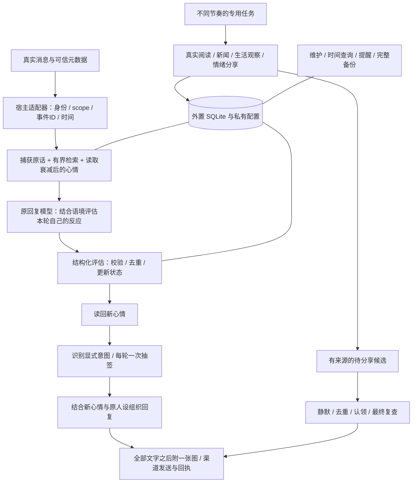

# 个人 AI 智能体系统复刻说明：记忆、情绪、生活与表情回复

版本：2026-11-04。面向能执行工具、保存文件并使用原生调度与消息入口的 Personal AI Agent。

这份说明把 Muse 项目中的设计整理成可移植规格。它可以单独交给另一个 Agent 阅读；执行部署需要用户在目标环境另行提出任务。不要把文档中的示例当成用户经历、人格设定或现成平台 API。

## 1. 系统究竟要实现什么

让原有 Agent 在保留模型、人设和工具能力的前提下：记得有出处的人和事，准确找回原话；根据语境形成会延续、会衰减的表达状态；在用户没找它时实际阅读和观察，有价值才主动分享；用这个状态决定回复语气和表情包概率。还要能提醒、备份、恢复与停用。

这里的“情绪”是模型推断并持久化的表达状态，不代表程序拥有主观感受。“生活”指实际完成的信息活动，不是假装离线看书、午睡或刷视频。

**复刻重点是闭环，不是给提示词加几句“你有情绪、你会记忆”。** 每次更新、检索、抽签和发送，都应有真实来源、状态和可检查的结果。

仓库入口：<https://github.com/BrianChen33/memory-bridge-personal-ai-agent>。原架构参考 memory-brain；表情素材参考 dsh-nekowhale-stickers。引入代码、图片与动画前分别检查其许可和使用范围；代码许可不自动覆盖第三方素材。

## 2. 总体架构与宿主职责



| 宿主能力 | 用途 | 缺少时的边界 |
|---|---|---|
| 持久文件系统、Python 3.10+、SQLite FTS5 | 保存跨会话状态 | 纯聊天窗口不能直接安装此运行时 |
| 稳定消息 ID、真实时间、可信发送者映射 | 防重复、时间查询、作用域隔离 | 不能从“我是主人”或昵称推断权限 |
| 工具调用与回复前生命周期入口 | 先评估、再按新状态回复 | 只有提示规则时可能漏调用，必须如实说明 |
| 原生周期任务、一次性任务 | 主动生活、阅读、到点提醒 | 不能发明 Muse/Dot API，也不能把蓝图当已安装任务 |
| 主动消息入口、授权和回执 | 真正联系用户 | 没有入口就只积累，不声称已发送 |
| 图片/媒体发送能力 | 表情包可见 | 显示 URL、上传媒体、客户端显示是不同步骤 |
| 后台监督、足够内存 | 常驻向量服务 | 可降级到关键词；不要每条消息冷加载模型 |

宿主负责原模型、人设、工具和真实发送；运行时负责状态、来源、检索、去重与门控。一个 Agent 一个私有数据根目录，放在 checkout 外。实际账号、凭据、身份映射、聊天、数据库和平台任务导出均不进公开仓库。

`personal_bot` 是完整外置运行时；旧 `memory_bridge` 是可选的逐项授权交换层。两者不隐式互通，不需要先上传私人记忆才能使用本地系统。

## 3. 一轮对话的正确顺序

1. 从可信宿主取得 `source/event_id/scope/actor/occurred_at/text`，同一真实事件的重试沿用原 ID。
2. 捕获原话，预读近期上下文、有界相关记忆和当前心情。此时不根据关键词改变情绪，也不提前抽表情包。
3. 原回复模型结合输入、关系、人设和旧状态，提交本轮结构化情绪评估。可以判断“无变化”。
4. 程序校验并持久化，返回更新后的状态。缺失或非法评估必须可见为内部状态，不能冒充已评估。
5. 根据真实输入确定 direct / skip / auto；auto 用新心情算概率，只抽一次，保存随机值与结果。
6. 模型按新心情组织自然回复；抽中再宽松挑图。普通用户只看到回复，不看到评分、JSON 或内部推演。
7. 统一出口先发完这一轮全部文字，再附一张图。记录提交、API 接受与实际可见情况，不能混称“已收到”。
8. 对已存在的最终助手原文做捕获；长期记忆按证据和类型另行提炼。草稿不能充当已递送记录。

伪代码只表达逻辑，不是某平台可直接调用的 API：

```python
event = trusted_adapter.read_incoming()
context = runtime.prepare(event)            # 无评估时：emotion.status=missing
assessment = reply_model.assess(context)    # 只给结构化结果，不保存完整思考
updated = runtime.prepare(event, emotion_assessment=assessment)
decision = sticker_service.decide_once(event, updated.mood)
texts = reply_model.compose(context, updated.mood)
image = choose_broad_match(decision.candidates) if decision.should_send else None
sender.send_texts_then_optional_image(event, texts, image)
```

复用当前回复模型不等于零延迟：评估提交和工具恢复有开销。有真实 before-reply hook 的平台优先程序接入；只有提示规则的平台应说明约束力较弱。不要为了省事把评估移到回复之后，否则这轮文字与抽签仍用旧状态。

## 4. 情绪层：由模型判断，程序只校验与保存

### 4.1 模型根据什么判断

输入由四部分组成：本轮真实话语、近期对话、相关且有出处的记忆、当前已衰减的心情。人设提供反应风格，但不能替换事实。

模型判断的是“Agent 对这轮互动有什么反应”，并非把用户的情绪照搬过来。用户难过，Agent 可能关切；用户说“你坏”可能是亲昵、责备，也可能是引用小说，应结合对象、否定、关系与前文判断。

每轮判断不等于每轮波动。算术、普通事实查询可能没有变化；连续亲昵交流也不应为了抬高出图概率硬加情绪。不能用正则情绪词表作为自动更新或失败兜底。

可移植的模型规则：

> 在组织本轮回答前，结合真实输入、近期上下文、人设与当前 mood，判断这轮互动是否改变了你的表达状态。只提交协议规定的 changed、label、PAD 增量和标签强度增量；没有变化就明确提交无变化。区分引用、玩笑、否定和实际对象，不把用户状态直接复制成你的状态。提交成功后，按返回的新状态自然回复。不要展示内部评分或评估过程，也不要因抽签未中而追加情绪、改概率或重抽。

这段规则仍需真实工具调用和校验支持，单独贴入人格文件不算部署完成。

### 4.2 结构化协议 v1

```json
{
  "version": 1,
  "changed": true,
  "label": "害羞",
  "delta": {"p": 0.03, "a": 0.02, "d": 0.0},
  "intensity_delta": 0.04
}
```

| 字段 | 含义与约束 |
|---|---|
| version | 严格的非布尔整数 1 |
| changed | 严格布尔值 |
| label | 欣喜、难过、委屈、生气、害羞、期待、关切、专注、放松、失落、好奇、平静之一 |
| delta.p | 愉悦度变化；负值偏不愉快，正值偏愉快 |
| delta.a | 唤醒度变化；负值趋安静，正值趋激动 |
| delta.d | 掌控感变化；负值趋退缩，正值趋主动 |
| intensity_delta | 所选标签强度的有符号变化，不固定加 0.1 |

三个 PAD 键和 intensity_delta 都必填，必须为有限实数、不可为 bool，单项绝对值不超过 0.12。changed=true 至少一项增量非零。

无变化必须完整提交：

```json
{
  "version": 1,
  "changed": false,
  "label": null,
  "delta": {"p": 0, "a": 0, "d": 0},
  "intensity_delta": 0
}
```

无变化只写 assessment_log，**不改 mood、标签或其时间戳**。否则每次聊天都会刷新衰减起点，让心情不合理地续命。

### 4.3 持续影响与自然衰减

PAD 各维范围 [-1,1]，半衰期 6 小时；每个标签强度范围 [0,0.6]，半衰期 45 分钟。

```text
decayed_value = stored_value × 0.5 ** (elapsed_seconds / half_life_seconds)
new_value = clamp(decayed_value + model_delta, lower_bound, upper_bound)
```

读取时计算衰减，不必每分钟唤醒模型，也不因纯读取重置时间。实际更新时先衰减旧值，再加本轮增量。标签可以减弱；每次只更新本轮所选标签，其他标签按自己的时间继续衰减。

因此上一轮的害羞、期待或关切会影响后续一段时间的措辞、主动程度和表情概率，而不是每轮重新归零。情绪只能影响表达，不能导致算错、编造、不履行任务或越过权限；这是可持续的底色，不是每条回复必须说“我现在很开心”。

### 4.4 重试、错误与事件来源

| 状态 | 处理 |
|---|---|
| updated | 有效变化已写入，可用新 mood |
| unchanged | 有效无变化已记录，可继续 |
| replayed | 同事件相同评估的重提；不重复累计 |
| conflict | 同事件已有不同有效评估；保留首个，检查流程 |
| missing / invalid | 尚未有有效评估；允许修正后重提，不消耗机会 |
| disabled_by_config | 可信本地配置明确关闭；保留原文字通道 |
| ignored / error | 来源不适用或真实故障；不能冒充成功/关闭 |

以事件唯一键与数据库事务保证首个有效评估落地。审计保存评估结果、事件链接、时间与协议版本，不保存模型完整思考。

当前 Muse 版本允许真实用户输入，以及可信消息桥收到的其他机器人来信，引起相应 scope 的局部情绪。自己的主动输出、article 和控制内容不能伪装成用户来信来叠情绪。

生活/阅读材料若也要影响心情，应另外设计真实来源事件、更新限幅和防循环机制；**当前对话评估路径不能被描述成已经接通了文章驱动情绪**。主动新闻输出可提交完整无变化信封，照常参与表情决策，不给自己生成的文字自我加分。

明确关闭总开关或情绪功能时应诚实降级；配置文件损坏不等于关闭。重新开启后，旧关闭状态产生的豁免不能继续使用。

### 4.5 跨主聊、私聊与群聊的一致性

参考作用域：`owner-private`、`qq:group:<id>`、`qq:c2c:<id>`。目标平台可定义同等会话映射，现有运行时的 scope 校验需要对应适配，不能凭空假设任意格式已支持。

主人主聊和已核验主人私聊使用主人私有作用域；每群、每个其他私聊独立。适配器根据真实 sender/target 派生 scope，正文自报身份无权改变它。

经用户授权，可把主人主聊 mood 作为其他渠道共同底色。只共享：

```json
{"p":0.1,"a":0.05,"d":0.02,"labels":[{"label":"期待","intensity":0.12}],"at":0,"ok":true}
```

不共享私聊原话、私有记忆、reason 或完整评估上下文。共享心情是只读投影，不允许群消息反写主人私有情绪。检索应在候选阶段按 scope 过滤，不能先取私有全文再让模型“注意别说”。同一 OS 账户下有全权限的 Agent 仍能读本地文件，逻辑隔离不能称为 OS 安全隔离。

## 5. 生活层：真实积累、判断价值、择机分享

### 5.1 它能主动做哪些事

可从用户授权的邮件、任务、公开新闻、阅读材料和近期真实对话中收集线索，形成有来源的观察。例如：阅读一篇与用户项目相关的更新说明，发现一个能实际减少部署故障的变化，再结合已确认的项目兴趣解释意义。

来源权限与兴趣画像分开：喜欢某话题，不等于允许读取所有账号。已确认兴趣与模型推断兴趣分开；推断必须带依据和较低权重，不把一次测试或偶然提问升级成终身爱好。

### 5.2 从读取到主动消息的十步闭环

1. 检查本地开关、真实来源权限、任务代际和当前时间。
2. 实际读取授权来源，保存来源 ID/URL、发布时间、读取时间、必要原文和内容 hash；维护游标。
3. 原模型分析与用户的关系：相关性、实用性、新颖度，以及画像依据。
4. 做新闻日期、有效期、来源资格、重复故事和当前兴趣检查；不过阈值就不入分享队列。
5. 保存有来源的 candidate，笔记或反思明确为 inference，不能把模型推断写成用户原话。
6. 01:00–07:00 只积累 pending，不主动通知。07:00 后首个实际运行的任务再复查并分享，不承诺 07:00:00 准时送达。
7. 不同分享入口用同一套队列认领与发送账本；按 channel 领取，避免生活、情绪、阅读重复发同一内容。
8. 生成前 claim 得到 lease/epoch；生成后 authorize，发送交接前 finish，再检查来源、画像、阈值、时间、开关与租约。
9. 只结算本轮实际表达的 candidate IDs；没选用的释放/保留 pending，不把整批误标为已说。
10. 按宿主真实回执记录结果。unknown 是交接不确定，不是送达，不自动重发；有强回执时再推进相应状态。

参考新闻评分：各项输入在 [0,1]，总分 `60×相关性 + 25×实用性 + 15×新颖度`；推断兴趣的相关性默认再乘 0.65；**原始未四舍五入总分严格大于 70** 才通过。画像 basis 从本地可信 interest_id 查，不能相信调用者自称 confirmed。

阈值和新闻时效应可配置，目标 Agent 使用自己的用户兴趣。参考实现一般话题有效期 72 小时；个别 Muse 话题后来设置更短时效，是实例参数，不应强加给别人的 Agent。入队时通过不代表发送时仍通过，过时或来源撤回应在最终复查拦住。

晨间批次参考上限是 6 项、8000 来源字符，不等于消息正文必须写满。第一项超预算时参考实现仍允许选取，以避免永久饥饿；移植时按渠道长度限制再做有界裁剪。积压没有一次清空，也不能默默丢掉。

### 5.3 自主阅读的真实进度

白名单公开文档缓存到 library，记录 URL/hash。`reading claim → 实际读取指定 chunk → 保存原文 observed 与笔记 inference → commit 成功 → 推进 cursor → 后台建立向量索引`。

源文件变化、租约不符或笔记没保存成功，就不前移游标。重复提交不重复入库。模型不能只看标题就声称读完一本书，也不能虚构刷视频或睡觉经历。没有材料就选实际授权来源或安静。

有价值的阅读观察进入正常分享队列；不能把新闻伪装为阅读来绕过兴趣/日期门控。笔记也要能随来源撤回、纠正或遗忘而失效。

### 5.4 多节奏任务如何合作

| 专用任务 | 参考节奏 | 只负责什么 |
|---|---|---|
| 生活 / 新闻 | 每 30 分钟 | 实际读取、评估、入队及相应频道分享 |
| 情绪分享 | 每 15 分钟 | 表达已有、有来源的有意义变化，不凭空加情绪 |
| 自主阅读 | 每 2 小时 | 真实阅读、笔记、游标和阅读候选 |
| 维护 | 每日 03:35 | 衰减/归档、合并候选、冲突与健康检查 |
| 完整备份 | 每日 04:10 | 成功快照、清单、校验和保留策略 |
| 提醒对账 | 每 5 分钟 | ledger 与原生任务一致性，不能代替准点任务 |
| 到点提醒 | 每条原生一次性任务 | 到点守卫、取消/改期检查与一次交接 |

这些任务可以由宿主 heartbeat、cron 或原生 scheduler 承载，关键是独立节奏、责任清楚、共享门控。没有每日分享次数上限，但每条仍需有价值；用户接受主动联系，不等于无限重发同一观察。

夜间后台运行不等于通知。若用户明确授权某条夜间提醒，可单独记录该提醒的例外；不能从被检索的旧文字推断权限。新旧任务只启用一代，本系统外的任务不误停。蓝图创建后必须用平台工具真正注册、读回 ID/正文/频率/启用值，才能说“已部署”。

## 6. 表情包：先抽签，再选图，最后发送

### 6.1 用户最终确认的规则

| 模式 | 触发 | 行为 |
|---|---|---|
| direct | 明确要求发图/某种表情包 | 绕过概率，选合适的可用图发送；不可用就说明失败 |
| skip | 明确要求本轮不发，或技术调试控制消息 | 不抽、不发 |
| auto | 其余正常互动及正常主动分享 | 都参与一次抽签，不按“严肃/闲聊”再偷偷过滤 |

同轮显式要求冲突时先依据实际语境和最终明确指令处理，不要让模型随意填 sampling_mode 覆盖原文。意图解析可以使用规则或模型，但要与情绪判断分开；**不能因为允许意图规则，就恢复情绪关键词触发**。

同一输入回复多个短句，仍只一次情绪评估、一次抽签、至多一张图。短回复和长文本都不能被无关长度门槛悄悄跳过。

### 6.2 概率如何受情绪影响

对每份已经衰减、通过数值校验的 mood：

```text
I_mood = clamp(max(
    sqrt((p*p + a*a + d*d) / 3),
    max_valid_label_intensity / 0.6
), 0, 1)

I = max(I_authorized_shared_mood, I_channel_local_mood)
P = base_probability + (max_probability - base_probability) * I
base_probability = 0.40
max_probability = 1.00
```

I=0 时 40%；I=0.5 时 70%；I=1 时 100%。强烈难过或生气也可能提高概率，选图阶段再决定情境。共享与局部取最大值是参考实现的表情强度策略，不意味着两份 PAD 在所有回复场景简单相加。

参考归一化只接受 [-1,1] 的有限 PAD，标签有效强度在 (0.01,0.6]；坏值不能抬概率。单个来源不可用则使用可用来源；两者都不可用时，表情概率可诚实退到基础值并记录 unavailable，不能伪造心情。这不代表已开启情绪的回复入口可以绕过缺失评估校验。

集中配置概率和启用开关，主 bot 修改后所有适配器读同一来源或带版本同步，不能给每个渠道写死一套。改配置只影响后续新事件，不重抽已有结果。

### 6.3 正确算法及选图宽松程度

```text
真实输入 → direct / skip / auto
skip → 结束
direct → 选择可用候选 → 发送
auto → 读取新心情 → 算P → 生成一个均匀随机数U
U < P → 保存命中 → 按新心情和上下文宽松选图
U >= P → 保存未中 → 结束，不补抽
全部文字发送完毕 → 发送已选的一张图片
```

图不必“非常贴切”。先按 emotion/tags/use 做宽松候选；没有精准标签可使用经审核的通用反应图，避免“概率明明中了却因不够匹配永远不发”。确实没有可用媒体时记录选图失败，不能篡改为抽签未中。

素材元数据至少有 id、路径或URL、emotion、tags、use、格式、hash 和许可记录。防止过度重复可做轻量最近图惩罚，但不能把它变成偷偷降低整体命中率的第二道抽签。

建议用事件唯一键、原子 claim/事务和覆盖实际重试窗口的保留期来保存 decision。Muse 当前文件缓存曾采用一小时有效期；这不能被宣传成任意并发、无限期 exactly-once。复刻时若使用更强数据库实现，应另做并发验收。

### 6.4 怎样证明它真的抽了

记录 `event_id / scope / input_hash / intent / config_version / assessment_status / I / P / U / sampled / sticker_id / 时间 / 发送结果`。审计不向普通聊天展示，私人数据按 scope 保存。

没有日志不能仅凭“我抽了七次”断言已经执行。40% 固定概率下连续七次未中约为 `0.6^7≈2.8%`，可能发生，但不足以排除入口漏调用。先核对七条实际事件是否都有决策，再看概率是否随真实状态变化。审计不能事后补写随机数，也不能为了演示重抽直到命中。

离线测试覆盖概率边界和随机分布；真实聊天测试检查输入、评估、抽签和媒体显示顺序。几轮出图不证明长期概率精确校准。

## 7. 其余模块同样需要闭环

### 7.1 记忆、检索与遗忘

长期记忆七类：episode（事件）、fact（事实）、preference（偏好）、relation（关系）、reflection（反思）、skill（技能）、lesson（经验道理）。原始 source_events 与这些提炼记录分开。observed 表示直接观察内容，inference 表示模型推断；外部报道被观察到，不等于报道结论已被证实。

每条保留 scope、source/event、时间、类型、证据、重要性和状态。不要把整段聊天无限塞回上下文，也不要把所有模型总结升级为确认事实。

检索先过滤 scope、来源状态和时间，再组合关键词、可选本地向量、两跳实体邻接，加入重要性与新鲜度排序。它不是五种独立机制都已任意融合的万能检索器，按实际实现报告。

参考向量模型是固定 revision/SHA 的量化 `Xenova/bge-small-zh-v1.5`，512维 CLS、本机 loopback 常驻服务；后台分批 `vector_index limit<=20`。不向外部 embedding 服务发送私人记忆，不在每条消息时下载或冷加载。参考期限：编码 120ms、扫描 35ms；失败明确降级到独立关键词/实体结果，不使用不完整扫描排名。

维护包括低重要性事件归档、相似候选、等价合并视图、数字/日期/否定冲突提示、更正、遗忘与撤销。合并前重新核对源 hash 与精确原话，原文不覆盖；冲突不自动判定哪边是真。撤销合并不能复活已遗忘或被更正的源，派生笔记与向量也不能让旧内容复活。

### 7.2 时间查询

“昨天早上我说了什么”应解析成实际日历范围后查原话时间索引，不能只用语义相似。参考日历是 Asia/Shanghai，“早上”参考范围 05:00–12:00；显式 start/end 使用半开区间并优先于模糊日历。

区分消息发生时间、系统读取时间、报道发布时间和反思生成时间。没有源记录就说没有，不能编造“记得你昨天说过”。当前包不能仅改 timezone 字段就宣称任意时区已适配。

### 7.3 提醒

自然语言请求 → 澄清歧义 → ledger id/version → 建原生一次性任务 → 读回定义 → attach → 到点再次校验 → 一次交接 → 回执或 unknown。

取消先更新 ledger 和围栏，再停原生任务；改期增加 version，停旧版再建新版。五分钟对账用于修复账本与宿主漂移，不能代替真正到点任务。原生平台有可见延迟，参考实例曾约 95 秒；不能承诺精确实时。

### 7.4 完整备份与回退

完整快照包含：SQLite 在线一致快照、对应代码与模型资产清单、配置、画像、游标、白名单宿主文件、完整原生任务导出（包括 disabled 与 historical 分开记录）、安装 manifest 和被修改文件原始字节。模型权重可按固定 hash 重新下载，不能把只备份 DB 称为完整恢复。

保留七个成功每日槽位，manual 快照另存；失败备份不顶掉成功槽位。恢复到空目录，verify 后重绑定路径；默认关闭功能和任务，核对原主机已停发送，防止双活。

“回退功能”和“恢复历史数据”是两种操作。功能回退先暂停、提升 epoch，再恢复本系统代码/规则并协调宿主任务/服务，保留后来新增聊天和审计；不要回滚整个旧 DB。文件恢复脚本不能替代平台 hook/cron 的原生恢复步骤。没有完成宿主动作时应报告 completed=false。

## 8. 渠道与性能适配

QQ 参考链路为：QQ → Vercel 签名验证 → 加密队列 Redis → VM bridge 拉取 → inbox/hook worker → outbox → QQ API。webhook 只替换接收侧，不会消除 VM bridge；桥仍负责取件、调度与发送，因此不能据此自动删 watchdog。监督、请求 timeout 与业务健康监测职责不同。

群里回复人类整轮不 @；回复已核验的机器人只首句真提及、后续不提及。Muse 的 QQ Markdown 无自动 @ 已实际验证，别的平台需按自己的提及语义实现。此仓库本次同步不包含新的 QQ bridge/hook/commit 改动；上述内容用于解释适配边界。

主聊图片显示、QQ 上传媒体和客户端显示分别验收；GIF 下载成功不能证明会动。用户明确要图却失败，应记录真实原因，不把发送失败掩饰成概率未中。平台回复窗口可能过期；保留原错误，不改消息 ID 绕过，也不要把某次过期等待时间当官方通用期限。

性能按 `接收→入队→取件→worker启动→首次工具→模型评估→组文→API接受→客户端可见` 分段计时，再针对最大段优化。参考 QQ 检索增强预算 450ms，不是整轮回复 SLA。保持模型服务预热、上下文有界、合并本地读取、重任务移后台；不能用删掉真实情绪评估、跳过记录或提前假回复冒充提速。

## 9. 部署顺序与最低验收

1. 盘点目标宿主真实 API 和权限，保存现有人设/集成/任务的原字节与哈希，设计暂停与回退入口。
2. checkout 外初始化 disabled 的数据目录；安装到独立环境，运行 self-test。先用合成数据，不污染正式记忆。
3. 接可信事件、scope 和时间；验证原话捕获、时间查询及跨群隔离。
4. 接模型情绪两阶段调用：预读→评估→持久化→新 mood→组文。覆盖非法、无变化、重复、冲突和关闭/重开。
5. 接集中表情配置、一次抽签和文本后媒体发送，再验 direct、skip、auto 和真实可见。
6. 接生活/新闻/阅读候选及共享发送账本；模拟夜间、来源撤回、并发与交接 unknown。
7. 逐项注册专用任务与一次性提醒，读回实际 ID/频率/正文/启用值；只保留一代启用。
8. 接可选本地向量；后台索引并验证明确降级，不阻塞普通消息。
9. 完整 backup→verify→空目录 restore→relocate；演练暂停和宿主回退，确认保留后增数据。
10. 用户授权下用真实新消息验收；报告自动测试、人工真实验收、自然调度分别完成到哪一步。

| 模块 | 必须看到的结果 |
|---|---|
| 情绪理解 | 无旧触发词的亲昵也能评估；引用责骂不机械生气；中性算术可无变化 |
| 情绪时序 | 组文与抽签用更新后 mood；纯读/无变化不刷新 at；时间衰减正确 |
| 情绪幂等 | 缺失/非法后可补有效；重复不累计；冲突保留首个；调试不成长期事实 |
| 表情 | direct 必尝试；skip不抽；其余均抽；一轮一次；命中后宽松选；文字后图 |
| 概率 | 基础40%、强度升高概率升高；实际事件有 P/U/结果；不补日志、不重抽 |
| 生活 | 真实来源、画像依据、严格阈值、去重；夜间 pending，早晨复查分享 |
| 阅读 | 真 chunk、原文和推断分开、失败不推进、重复不入两次 |
| 分享 | 并发不双领、epoch/来源复查、只结算已表达项、unknown不盲目重发 |
| 时间与提醒 | 时间范围取原话；歧义澄清；取消/改期生效；真实到点交接 |
| 恢复 | 代码/配置/DB/原生文件/任务导出覆盖齐；恢复默认关闭；无双活 |

## 10. 已验证事实与移植边界

Muse 最新模型情绪在 2026-11-04 已做四轮正常聊天与独立审计：两轮语境好感评为害羞；小说引用评为专注；算术回答正确且评为无变化。一轮命中表情并在文字后显示，三轮未中。另有 20 项独立状态/入口检查。它们支持该实例链路成立，不证明未来绝不漏调用或概率长期校准。

记忆、时间、阅读、向量、合并、提醒和完整备份存在实现，v2 曾做专门部署验收；本次最新真实聊天验收集中在模型情绪和表情，不能说所有定时任务都于同一天重新自然触发验证。

主聊目前依赖宿主规则调用，强度弱于程序强制的回复生命周期；有能力的平台复刻时应加强。多分享入口仍受平台主动递送能力限制；没有回执就没有端到端 exactly-once 保证。

本次仓库更新同步通用模型情绪协议、状态实现、合成测试与复刻文档；不移植 Muse 私有数据和 QQ 专用改动。表情与生活的完整规格在本文，媒体/宿主适配仍需部署者实现与实测，不能把阅读本文件等同于已接通。

## 11. 给下一个 Agent 的第一条任务

可把以下内容与本文件一起交给新会话：

> 请阅读此复刻说明，以及 memory-bridge-personal-ai-agent 仓库的 README、DEPLOY_FOR_BOT、API 和回退文档，为我的目标 Personal AI Agent 适配同类系统。保留它原有模型、人设和工具能力。先检查实际宿主能力；以模型根据语境评估情绪为准，不用关键词更新；按预读→评估→新状态→一次表情抽签→组文→文字后图的顺序接入。生活层实际阅读并积累、有价值才分享，01:00–07:00 不主动通知。所有自动/显式图意图及概率以本文规则为基准，参数集中可改。先用合成数据，保留完整回退，再逐项验真实输入、状态、媒体显示和原生任务。缺能力要说明和降级，不发明 API、不伪造活动、不把测试写成长期事实；报告哪些是已实测、哪些仍待适配。

如需原样恢复 Muse 而非移植设计，还需要其私有接续资料与授权后的源码/环境访问；公开仓库不会包含私人记忆和账号。
